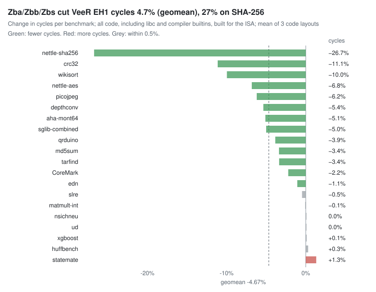

# Bit-Manipulation Extensions: Implementation and Performance

This fork of VeeR EH1 implements the RISC-V bit-manipulation extensions Zba, Zbb and Zbs (all 29 RV32 instructions, together the B extension) as single-cycle ALU instructions.
With all code built for them, including libc and the compiler builtins, EH1 runs Embench-IoT and CoreMark in **4.67% fewer cycles** (geometric mean) and with **2.51% smaller code**; SHA-256 is 26.7% faster.
The added logic is about 4.4k NAND2 equivalents, and in a LUT6 mapping the ALU's outputs gain no logic levels.

For the instructions, configuration options and design, see the [Bit-Manipulation Extensions](source/bit-manipulation.md) chapter of the documentation.

## Results

Cycles fall 4.80% on Embench and 2.21% on CoreMark (191,315 to 187,079 ticks per iteration).
The instruction count falls 4.44% on Embench, so nearly all of the gain is fewer instructions at an unchanged CPI.

- **nettle-sha256:** `rori` replaces three-instruction rotates.
- **crc32 and wikisort:** much of their gain comes from the libraries (crc32 −5.6% and wikisort −5.8% with only the benchmark code built for Zb). wikisort's soft-float routines (`__adddf3`, `__divdf3`, `__floatsidf`) use `clz`, `bseti` and `sh*add`; `__adddf3` shrinks from 486 to 327 instructions. crc32's inner loop calls a support routine whose mask becomes one `bclri`.
- **Library string functions:** picolibc's `strlen` uses `orc.b` with Zbb (69 instructions instead of 123). `memcpy`, `memset`, `memcmp`, `memmove` and `strchr` compile to the same code with or without the extensions.
- **The 4-7% group** (AES, picojpeg, depthconv, aha-mont64, sglib): `sh*add` address arithmetic, `minu`/`maxu`, `zext.h` and `sext.*`.
- **No change:** nsichneu and ud execute the same instructions as before.
- **Small increases:** these are code-layout effects. statemate executes exactly the same number of instructions and varies by 8.6% across layouts. huffbench executes 4.2% fewer instructions but takes more branch mispredictions.

| Benchmark | Before (cycles) | After (cycles) | Cycles | Instructions | Code size |
| --- | ---: | ---: | ---: | ---: | ---: |
| nettle-sha256 | 2,475,337 | 1,813,485 | −26.7% | −29.4% | −16.5% |
| crc32 | 3,136,434 | 2,787,433 | −11.1% | −8.7% | −2.5% |
| wikisort | 791,899 | 713,000 | −10.0% | −5.6% | −7.3% |
| nettle-aes | 1,792,088 | 1,669,894 | −6.8% | −8.3% | −2.6% |
| picojpeg | 2,140,450 | 2,007,879 | −6.2% | −4.1% | −0.3% |
| depthconv | 1,590,439 | 1,505,214 | −5.4% | +1.7% | −2.5% |
| aha-mont64 | 3,950,924 | 3,749,377 | −5.1% | −7.9% | −1.4% |
| sglib-combined | 2,870,663 | 2,727,070 | −5.0% | −5.8% | −1.0% |
| qrduino | 2,462,585 | 2,367,702 | −3.9% | −4.5% | −3.8% |
| md5sum | 1,397,674 | 1,350,401 | −3.4% | −3.4% | −1.3% |
| tarfind | 1,062,574 | 1,026,865 | −3.4% | +2.9% | +0.3% |
| CoreMark (ticks/iter) | 191,315 | 187,079 | −2.2% | −2.6% | −0.8% |
| edn | 1,475,950 | 1,460,156 | −1.1% | −1.2% | −1.4% |
| slre | 2,845,489 | 2,832,155 | −0.5% | −0.6% | −2.8% |
| matmult-int | 1,040,327 | 1,039,575 | −0.1% | 0.0% | +2.8% |
| nsichneu | 2,431,616 | 2,431,616 | 0.0% | 0.0% | −0.3% |
| ud | 955,055 | 955,056 | 0.0% | 0.0% | −1.4% |
| xgboost | 3,561,231 | 3,565,392 | +0.1% | −0.1% | −2.6% |
| huffbench | 1,692,751 | 1,697,924 | +0.3% | −4.2% | −2.7% |
| statemate | 2,424,316 | 2,456,503 | +1.3% | 0.0% | −0.7% |

Instructions are dynamic counts. Code size is the `.text` of the whole image (benchmark, runtime, libc and builtins). All figures are means over 3 code layouts.

**Control.** The rv32imc binaries produce exactly the same cycles, instructions, mispredictions and code size on this core as on the upstream core, for all 20 benchmarks. So do the upstream regression tests (`hello_world*`, `cmark*`, `dhry`).

## What Each Extension Is Worth

Each row below uses this core with all code, libraries included, built for one extension only, at the default layout.
Single-layout figures carry each benchmark's layout noise (slre and statemate move by up to 10%), so the geometric mean is the number to read.

| Built with | Cycles (geomean) | Code size | Largest changes | Zb instructions in the 20 images (in libraries and runtime) |
| --- | ---: | ---: | --- | --- |
| Zba only | −1.76% | −0.85% | wikisort −8.8%, picojpeg −7.6%, nettle-aes −6.7%, crc32 −5.6% | 1,640 (158) |
| Zbb only | −2.19% | −1.58% | nettle-sha256 −26.7%, picojpeg −4.1%, depthconv −3.3%, md5sum −2.5% | 643 (35) |
| Zbs only | +0.17% | −0.07% | crc32 −5.6%, tarfind −3.5% | 106 (73) |
| All three | −4.21% (−4.67% over 3 layouts) | −2.53% | see Results | 2,388 (264) |

- **Zba** helps wherever there is indexed addressing, soft-float included. Its three instructions cost one 4:1 multiplexer per ALU.
- **Zbb** is the broadest and does most of the code-size reduction: rotates, `min`/`max`, sign and zero extension, `orc.b` in `strlen`, and `clz` in soft-float normalization.
- **Zbs** is mostly used in the libraries and runtime (73 of its 106 instructions). It targets register and flag manipulation, which these benchmarks barely exercise.

## Method

- **Benchmarks:** CoreMark (the testbench's `cmark.c`, 10 iterations, ticks per iteration) and 19 Embench-IoT benchmarks (commit `09c2ed8`). Each runs on the Verilated core (default configuration with ICCM): code in ICCM, data in DCCM, one warm-up call, then one measured call timed with `mcycle` and `minstret`. Every run self-checks its result.
- **Compiler:** LLVM 23.1.2 (official release), `-O3 -mcpu=generic-rv32 -mtune=sifive-7-series`.
- **Libraries:** picolibc 1.8.10 and the compiler-rt 23.1.2 builtins, built from source for each ISA with the same compiler, `-O3 -mtune=sifive-7-series` and `-mabi=ilp32`. The runtime (crt0, printf, the Embench support code) is built for the same ISA as well.
- **Before:** the upstream core (`d04b1c7`), all code built for `rv32imc_zicsr_zifencei`.
- **After:** this core, all code built for `rv32imc_zba_zbb_zbs_zicsr_zifencei`.
- **Layouts:** both are run with the default function alignment and with `-falign-functions=8` and `=32`, and the three are averaged. This damps code-placement effects on fetch and branch prediction.
- **Simulator:** Verilator 5.020.
- **Reproducing:** [`tools/bench/bench.sh`](../tools/bench/README.md) builds the libraries, both cores and every benchmark from source, runs all configurations, and regenerates the results table and chart above.

## Implementation and Cost

Most of the new instructions reuse existing ALU units: the adder, the logic unit and the shifter.
The full mapping is in the [documentation chapter](source/bit-manipulation.md).
Two choices keep logic off the ALU's timing paths.
The Zba shift is applied as *rs1* is written into the ALU operand register, so neither the adder nor the branch-resolution path that shares it gains any logic.
The signed and unsigned less-than result is taken from the adder's carry-out and the operand sign bits, which takes the adder's sum and the overflow term off the branch path.
That rewrite is proven equivalent with a SAT miter.

Synthesis of one ALU instance and one instruction decoder with Yosys 0.52; [`tools/synth/synth.py`](../tools/synth/README.md) regenerates these tables.
LUT6 levels are counted from a register or input to the named output, with a depth-oriented mapping.
Area is the logic mapped to a generic cell set, in NAND2 equivalents, without flip-flops.

| One ALU instance | Upstream | Extensions configured out | This core |
| --- | ---: | ---: | ---: |
| Branch redirect `flush_upper` (LUT6 levels) | 7 | 7 | 7 |
| Branch target `flush_path` | 7 | 7 | 7 |
| Result and bypass `out` | 7 | 7 | 7 |
| LUT6 count | 605 | 596 | 923 |
| Logic area (NAND2 eq) | 2,044 | 1,976 | 3,074 |

| One instruction decoder | Upstream | This core |
| --- | ---: | ---: |
| Deepest output (LUT6 levels) | 4 | 5 |
| LUT6 count | 108 | 157 |
| Logic area (NAND2 eq) | 238 | 361 |

The extensions add no LUT levels to the ALU's outputs in this mapping, and one level to the decoder.
They add about 1,030 NAND2 equivalents per ALU (four ALUs) and 123 per decoder (two decoders), about 4.4k NAND2 equivalents of logic in all, plus 72 pipeline flip-flops.
With all three extensions configured out, the ALU has 3% less logic than upstream, because one funnel shifter replaces three shifters.
The decoder is measured on its own, where it is the same for every configuration; the controls of a configured-out extension are tied off at its outputs, so part of its added logic is removed as well.
These are open-source synthesis estimates for comparing the variants, and LUT levels depend on the mapping recipe; timing closure for a given technology needs a run with its cell library.

## Verification

| Check | Coverage | Result |
| --- | --- | --- |
| Decoder (SAT) | All 62 decode outputs against `design/dec/decode`; the legal-instruction equation against all 2^32 encodings | Proven |
| Less-than rewrite (SAT) | New compare against the original, all inputs | Proven equivalent |
| `bitmanip` test | Every instruction on about 5,900 edge-case vectors, with operands delivered through immediates, DCCM loads, multiplies and back-to-back results, in both pipes. 22 neighboring encodings must trap with the instruction in `mtval` | Pass |
| `bitmanip_random` test and a 40-seed sweep | Random mix of bit-manipulation, ALU, load, store, multiply and branch instructions; all registers and memory checked | Pass (163,000 instructions) |
| QEMU cross-check | The same programs built for QEMU's independent implementation, to validate expected values | Pass |
| Coverage | Every operation class in all four ALUs (two pipes, primary and secondary) | All hit |
| Mutation testing | 9 injected RTL bugs | All caught |
| RISC-V Architectural Certification Tests | riscv-arch-test (ACT4, commit `3d5cc36`) with expected results from the Sail 0.16 reference model configured as RV32IMCB: 160 tests, 29 of them Zba, Zbb and Zbs, the rest the base I, M, C, CSR, exception and interrupt tests. Excluded, as for the upstream core: `Zifencei` and `I-fence` (see `tools/arch-test`) | Pass (160 of 160) |
| RISC-V Architectural Certification Tests, extensions off | The same run with Zba, Zbb and Zbs configured out, against riscv-arch-test's unmodified VeeR EH1 RV32IMC configuration: the 131 base and privileged tests | Pass (131 of 131) |
| Upstream regression | `hello_world`, `cmark` and `dhry` variants | Pass, cycle-identical to upstream |
| Configurations | AXI4, AHB-Lite, Zbb off, Zba and Zbs off, all off | Pass |
| Benchmarks | All 20 benchmarks, all configurations | Results self-verify |
